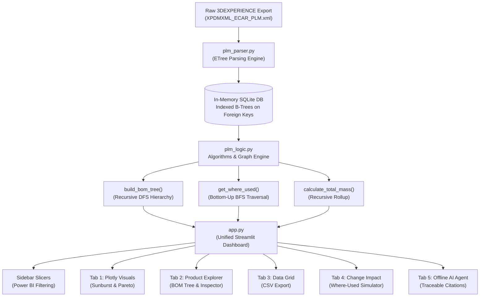

# ⚡ 3DEXPERIENCE PLM Product Intelligence & Change Impact Platform

[](https://www.python.org/)
[](https://streamlit.io/)
[](https://plotly.com/)
[](https://www.sqlite.org/)
[]()
[]()

An enterprise-grade PLM analytics dashboard, change impact simulator, and offline engineering AI agent developed for a Tier-1 automotive electric powertrain supplier. This platform ingests raw **Dassault Systèmes 3DEXPERIENCE XPDMXML** data and transforms it into an executive-level Power BI-style decision cockpit.

---

## 🎯 Project Overview & Challenge Context

Automotive engineering teams working on high-voltage electric drive units face major friction when extracting insights from raw PLM exports. Complex XML hierarchies, multi-level assemblies, missing material definitions, and untracked engineering changes slow down release gates and CAE simulation loops.

This project delivers a high-performance, single-application solution built for the **410 kW Electric Drive Front Assembly** (`ECAR-EI_410KW_EDRIVE_FRONT`, PLM ID `prd-12535825-00000047`), addressing:
1. **Multi-level BOM navigation** from root assembly down to leaf fasteners.
2. **Automated risk & compliance audits** (unassigned materials, lifecycle maturity freeze).
3. **Upstream change impact analysis** (Where-Used bottom-up graph traversal with projected mass deltas).
4. **Interactive Power BI-style visual analytics** (Plotly sunburst hierarchy drill-down, Pareto distributions).
5. **Autonomous PLM AI Agent** (100% offline, zero external APIs, strict data boundary enforcement, and mandatory PLM ID traceability).

---

## 🚀 Key Features

### 1. 🎛️ Power BI-Style Slicers & Dynamic Filtering
- **Material Slicer**: Multi-select filtering by CAD material (Aluminium, Steel, Copper, etc.) with explicit detection for `⚠️ Missing / Unassigned`.
- **Maturity Slicer**: Filter by lifecycle state (`IN_WORK`, `FROZEN`, `RELEASED`).
- **Mass Range Slider**: Dynamic slider isolating components between specific weight thresholds (`0.000 kg` to `100.100 kg`).
- **Real-Time Slicer Telemetry**: Live metrics reflecting the active filtered scope across all charts and AI responses simultaneously.

### 2. 📊 Interactive Dashboard (Tab 1)
- **Sunburst Hierarchy Drill-Down**: Interactive Plotly Sunburst chart showing the complete BOM structure where each slice is sized proportionally by its CAD mass. Users can click any branch (e.g. E-Motor, Reducer, Housing) to zoom and inspect deeper levels.
- **Material Distribution Bar Chart**: Visual breakdown of component counts by material, featuring automated color-coding (red alert for missing materials).
- **Mass Pareto Analysis**: Top 10 individual weight drivers ranked across the active selection to focus lightweighting efforts.

### 3. 🌳 Product Explorer & CAD Inspector (Tab 2)
- **Recursive Tree Navigation**: Collapsible multi-level assembly explorer displaying instance names, revisions, maturity states, declared masses, and material tags.
- **Component Inspector**: Real-time dropdown search by part name or PLM ID (`prd-...`) displaying detailed CAD metadata cards, organization, project context, and recursive subassembly mass rollups.

### 4. 📋 Filtered Data Grid (Tab 3)
- Clean, searchable, and sortable tabular view powered by `st.dataframe`.
- One-click **Export to CSV** button (`📥 Export Filtered View to CSV`) respecting all active slicer selections.

### 5. 🔄 Change Impact Analysis (Tab 4)
- **Where-Used Reverse Traversal**: Breadth-First Search (BFS) algorithm that traverses from any selected leaf component upward through `Instancing` and `Owned` relationships to identify all affected parent assemblies up to the root.
- **Traceable Upstream Breadcrumbs**: Visual path indicators showing exactly how a part traces upward (e.g., `Level 1 -> Level 2 -> Root`).
- **Mass Delta Simulation**: Live simulation calculating projected vehicle mass changes when replacing a part with a proposed alternative.

### 6. 🤖 Native PLM Engineering AI Agent (Tab 5)
- **100% Offline & Reliable**: Powered by an autonomous local reasoning engine running directly against SQLite/Pandas without any external APIs, rate limits, or network dependencies.
- **Strict Data Boundary (Rule 1)**: Any inquiry outside the provided PLM extraction returns:  
  `"That information is not available in the current PLM extraction."`
- **Mandatory Traceability (Rule 2)**: Every cited component strictly includes its verified PLM ID in parentheses (e.g. `ECAR-EI_motor (prd-12535825-00000071)`).
- **Grounded in Slicer Context**: Dynamically analyzes the currently filtered subset of the BOM.
- **One-Click Quick Prompts**:
  - `🔩 What parts use Aluminium?`
  - `⚖️ Show heaviest component`
  - `🚨 Audit missing materials`
  - `🏗️ Major subassemblies`
  - `Where is <part> used?`

---

## 🔍 Critical Engineering Findings

| Metric | Value | Engineering Significance |
| :--- | :--- | :--- |
| **Root Assembly Mass** | **100.100 kg** | `ECAR-EI_410KW_EDRIVE_FRONT (prd-12535825-00000047)` |
| **E-Motor Mass Share** | **39.730 kg (39.7%)** | Heaviest subassembly: `ECAR-EI_EMOTOR FRONT (prd-12535825-00000048)` |
| **Reducer Mass Share** | **29.850 kg (29.8%)** | Transmission unit: `ECAR-EI_REDUCER FRONT (prd-12535825-00000049)` |
| **Housing Mass Share** | **30.520 kg (30.5%)** | Structural shell: `ECAR-EI_HOUSING FRONT EDRIVE (prd-12535825-00000050)` |
| **Missing Materials** | **6 Components** | Compliance risk: Screws, washers, O-rings, and retaining rings lack material definitions. |
| **Maturity Freeze Risk**| **100% `IN_WORK`** | **0% of components are in `RELEASED` state**, highlighting major design freeze risk. |
| **BOM Tree Nodes** | **144 Nodes** | Multi-level hierarchy across 79 unique products and 112 instances. |

---

## 🏛️ System Architecture



---

## 📂 Standard Project Structure

```text
d:\PLM\
├── XPDMXML_ECAR_PLM.xml      # 3DEXPERIENCE PLM XML extraction (BOM & metadata)
├── P7_PLM_ESILV_VF.pptx      # ESILV Hackathon challenge brief & specifications
├── plm_parser.py             # XML parser & relational SQLite database manager
├── plm_logic.py              # Recursive BOM tree, Where-Used BFS, & mass calculations
├── app.py                    # Unified Streamlit application (5 interactive tabs)
├── index.html                # Modern Web landing page & live offline demo (Netlify)
├── netlify.toml              # Netlify static deployment configuration
├── requirements.txt          # Python dependencies
├── .gitignore                # Git exclusions
└── README.md                 # Project documentation (this file)
```

---

## ⚡ Quickstart & Installation

### 1. Prerequisites
- Python 3.10 or higher
- Git

### 2. Clone the Repository
```bash
git clone https://github.com/Shubhu1-ai/PLM_Hackathon.git
cd PLM_Hackathon
```

### 3. Install Dependencies
```bash
pip install -r requirements.txt
```

### 4. Run the Streamlit Application
```bash
streamlit run app.py
```

The application will launch in your default web browser at `http://localhost:8501`.

---

## 🤖 Interacting with the Native AI Agent

The AI Assistant in **Tab 5** runs fully offline without requiring any third-party API keys or internet connection. It strictly enforces automotive engineering rigor:

| Query Type | Example Prompt | Agent Response Behavior |
| :--- | :--- | :--- |
| **Material Audit** | *"What parts use Aluminium?"* | Filters active BOM, returns count, names, and explicitly cites PLM IDs (e.g. `prd-12535825-00000050`). |
| **Weight Drivers** | *"Show me the heaviest component."* | Distinguishes between top-level assembly, heaviest subassembly, and leaf component with mass rollups. |
| **Compliance Risk** | *"Are there any missing materials?"* | Lists all 6 components missing material tags with revision indices and warnings. |
| **Where-Used Search** | *"Where is BEA3 used?"* or *"Where is Housing used?"* | Executes upward BFS traversal and outputs all parent levels and instance connectors. |
| **System Architecture** | *"What are the major subassemblies?"* | Decomposes the 100.100 kg assembly into E-Motor, Reducer, and Housing. |
| **Boundary Violation** | *"What is the battery chemistry?"* | Returns: `"That information is not available in the current PLM extraction."` |

---

## 🌐 Netlify Deployment

The project includes an `index.html` file configured with `netlify.toml` for static web hosting on Netlify. When pushed to GitHub, Netlify automatically builds a landing page featuring:
- Live KPI ribbon & system metrics
- Architecture breakdowns and feature showcases
- Client-side interactive offline AI Assistant simulation
- Links to launch the full Python Streamlit dashboard

---

## 📜 License & Acknowledgments

- **Challenge**: ESILV Automotive Engineering Hackathon 2026
- **Dataset**: Dassault Systèmes 3DEXPERIENCE Platform (`XPDMXML` Export)
- **License**: MIT License
